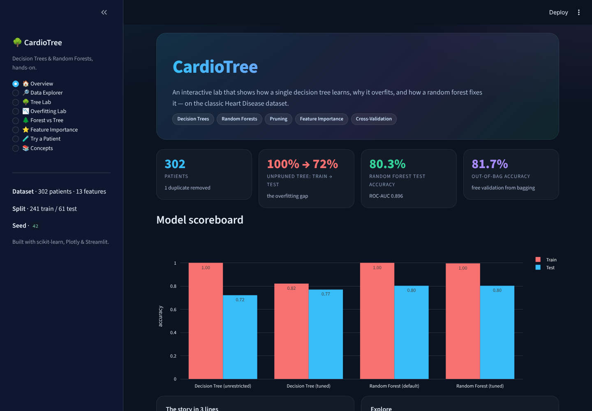
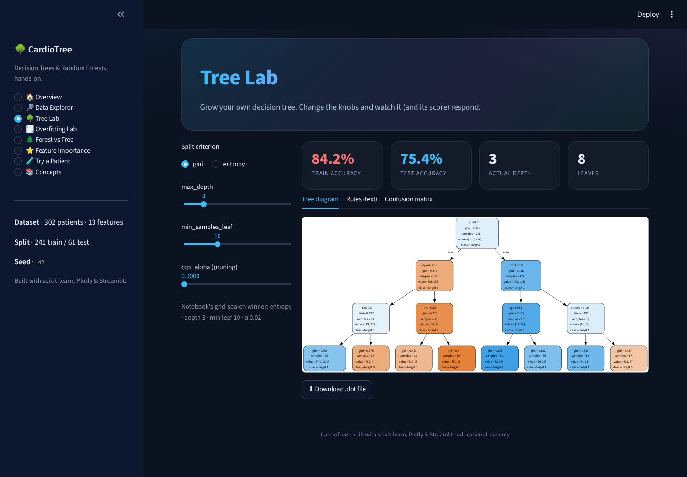
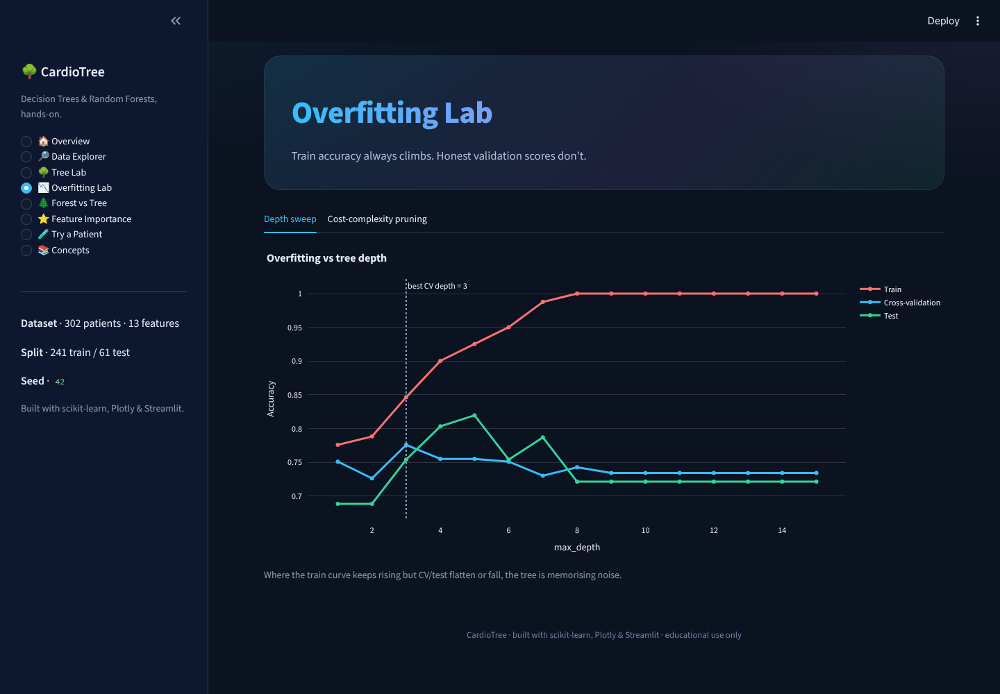
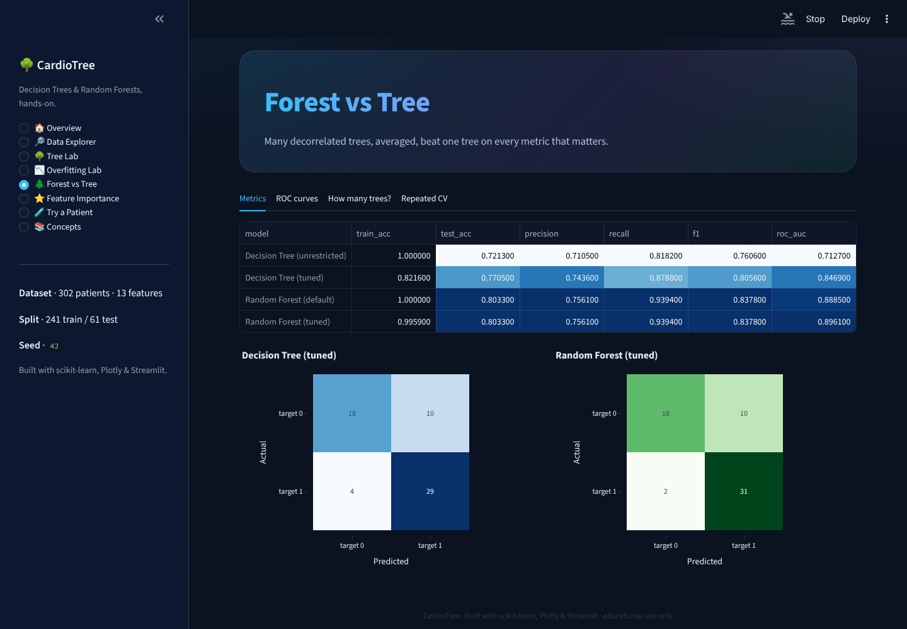
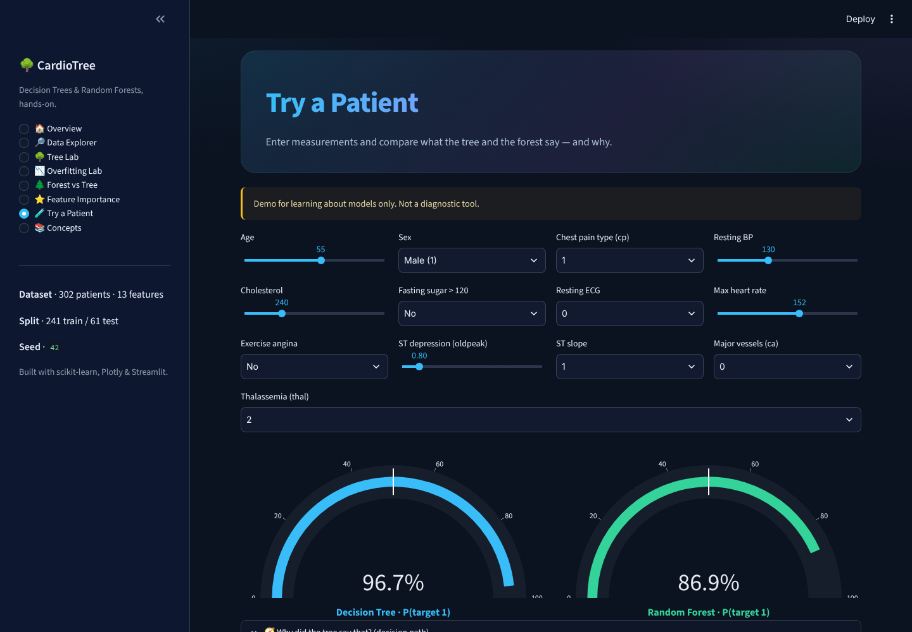

<div align="center">

# 🌳 CardioTree

### An interactive lab for **Decision Trees & Random Forests** on heart-disease data

*See how a single tree learns, watch it overfit, then watch a forest fix it — all in your browser.*




</div>

---

## ✨ What is this?

CardioTree turns my **Decision Trees & Random Forests** notebook into a full interactive app. Every experiment from the notebook is a page you can play with — change a hyper-parameter and the tree, the scores and the charts update instantly.

**The question it answers:** *why does a single decision tree memorise its training data, and why does averaging many trees fix it?*

## 🧭 App tour

| Page | What you can do |
|---|---|
| 🏠 **Overview** | Scoreboard of all four models; the whole story at a glance |
| 🔎 **Data Explorer** | Browse the data, per-feature distributions by class, correlation heatmap, data dictionary |
| 🌳 **Tree Lab** | Grow your own tree (criterion, depth, min leaf, pruning α); live diagram, text rules, confusion matrix, `.dot` export |
| 📉 **Overfitting Lab** | Train vs cross-validation vs test across depth, and across cost-complexity pruning |
| 🌲 **Forest vs Tree** | Metrics, ROC curves, “how many trees?” (test vs OOB), repeated cross-validation |
| ⭐ **Feature Importance** | Impurity-based, permutation, and information-gain views |
| 🧪 **Try a Patient** | Enter measurements → tree vs forest probabilities, the tree's decision path, the forest's vote count |
| 📚 **Concepts** | Plain-language Q&A: entropy, information gain, OOB, bagging, importance pitfalls |

<table>
<tr>
<td></td>
<td></td>
</tr>
<tr>
<td></td>
<td></td>
</tr>
</table>

## 📊 Results

Dataset: **302 patients** (303 rows, 1 exact duplicate removed), 13 clinical features, binary `target`. Stratified 80/20 split (241 train / 61 test), `random_state=42`.

| Model | Train acc | Test acc | F1 | ROC-AUC |
|---|---|---|---|---|
| Decision Tree (unrestricted) | 1.000 | 0.721 | 0.761 | 0.713 |
| Decision Tree (tuned) | 0.822 | 0.770 | 0.806 | 0.847 |
| Random Forest (default) | 1.000 | 0.803 | 0.838 | 0.889 |
| **Random Forest (tuned)** | 0.996 | **0.803** | **0.838** | **0.896** |

Repeated stratified 5-fold CV (5 × 3 = 15 scores) on the full dataset:

| Model | Accuracy | F1 | ROC-AUC |
|---|---|---|---|
| Decision Tree (unrestricted) | 0.751 | 0.772 | 0.747 |
| Decision Tree (tuned) | 0.796 | 0.819 | 0.829 |
| Random Forest (default) | 0.821 | 0.842 | 0.914 |
| Random Forest (tuned) | 0.820 | 0.840 | 0.914 |

**Takeaways**
- An unrestricted tree hits **100% on train but ~72% on test**: classic overfitting.
- Limiting depth / pruning narrows the gap and improves honest scores.
- A random forest beats a single tree on every metric, with **ROC-AUC ≈ 0.90** and a free **OOB accuracy ≈ 0.82**.
- Tuned hyper-parameters (picked on the training split) are slightly optimistic in CV; nested CV would remove that bias.

> Exact numbers can differ a little from the notebook run on Kaggle because the CSV copy used here has a different row order (so the split differs). Every figure above is reproduced by `python scripts/train.py`.

## 🚀 Quick start

```bash
git clone <your-repo-url> cardiotree
cd cardiotree

python -m venv .venv && source .venv/bin/activate   # Windows: .venv\Scripts\activate
pip install -r requirements.txt

streamlit run app.py
```

Open http://localhost:8501. Other commands:

```bash
python scripts/train.py   # train all models, print metrics, write outputs/metrics.json
pytest -q                 # run the test-suite
```

## 🗂️ Project structure

```
cardiotree/
├── app.py                  # Streamlit app (8 pages)
├── src/
│   ├── config.py           # constants, palette, tuned hyper-parameters
│   ├── data.py             # load → dedupe → stratified split
│   ├── models.py           # training, sweeps, CV, importances, entropy / info-gain helpers
│   └── theme.py            # custom CSS, KPI cards, gauges, Plotly theme
├── scripts/train.py        # headless training + metrics export
├── tests/test_pipeline.py  # data, overfitting, info-gain and decision-path tests
├── notebooks/              # the original analysis notebook
├── data/heart.csv          # Heart Disease dataset (UCI / Cleveland features)
├── assets/                 # app screenshots used in this README
├── .streamlit/config.toml  # dark theme
└── requirements.txt
```

## 🧠 Method in brief

1. **Clean** – drop duplicate rows (duplicates leak between train and test and flatter deep trees).
2. **Split** – stratified 80/20, fixed seed.
3. **Single tree** – Gini / entropy splits; visualised with `export_graphviz` (rendered live in the app).
4. **Control overfitting** – `max_depth` sweep, cost-complexity pruning (`ccp_alpha`), 5-fold grid search → *entropy, depth 3, min leaf 10, α 0.02*.
5. **Information gain** – computed by hand and verified against scikit-learn (see tests).
6. **Random forest** – 300 bagged trees, random feature subsets, OOB score; grid search → *max_depth 8, `sqrt` features*.
7. **Interpretation** – impurity vs permutation importance (prefer permutation on unseen data).
8. **Evaluation** – repeated stratified cross-validation, ROC, confusion matrices.

## ⚠️ Notes & limitations

- **Educational project, not medical advice.** Nothing here is a diagnostic tool.
- The two classes are called **target 0 / target 1**. Public copies of this dataset disagree on which direction means “disease”, so I make no clinical claim about the label. This doesn't affect any model or metric.
- Small dataset (302 rows) → test-set metrics move by several points with a different split; trust the repeated-CV numbers more.

## 🛣️ Ideas for next steps

- Gradient boosting (XGBoost / LightGBM) comparison
- Nested cross-validation and probability calibration
- SHAP explanations on the *Try a Patient* page
- Deploy to Streamlit Community Cloud

## 📄 License & data

Code: MIT (see `LICENSE`). Data: Heart Disease dataset (UCI Machine Learning Repository, Cleveland database) — please cite the original source when you reuse it.

<div align="center">

**Made with 🌳 and curiosity.** If you like it, give it a ⭐

</div>
